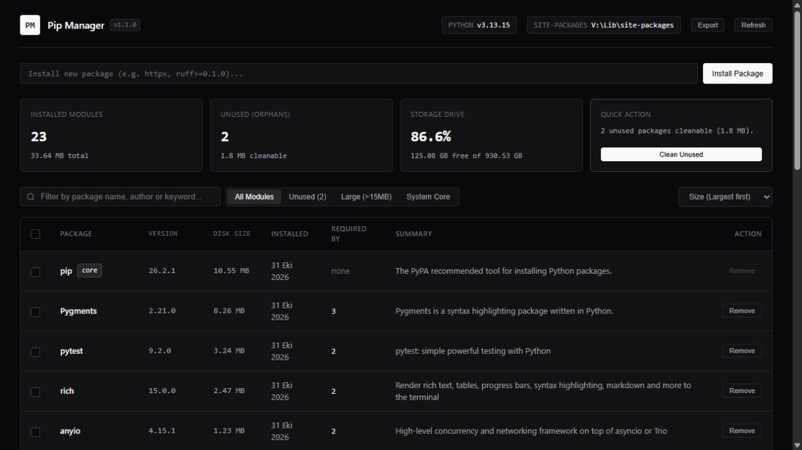
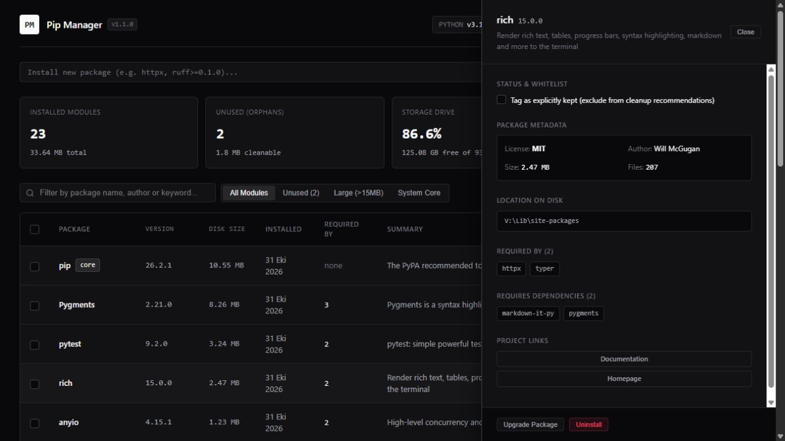
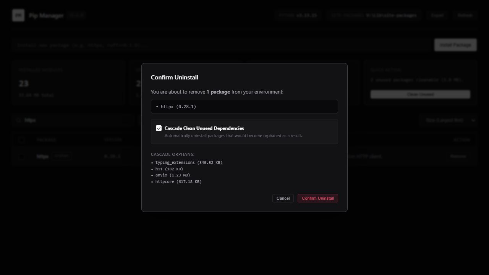

<div align="center">

# PipManager

**See what's in your Python environment. Understand it before you clean it.**

A local web interface for inspecting packages, exploring dependencies, and managing installs with pip.

[](server.py)
[](frontend/)
[](#requirements)
[](LICENSE)

[Quick start](#quick-start) · [Features](#features) · [Screenshots](#screenshots) · [How cleanup works](#how-cleanup-works)

</div>



PipManager gives your installed Python packages a searchable, sortable interface. Find large packages, follow dependency relationships, mark tools you want to keep, and review a removal plan before running it—all from your browser.

Built with the Python standard library and plain HTML, CSS, and JavaScript. No frontend build step, application dependency install, external fonts, or CDNs.

## Quick start

```bash
git clone https://github.com/eco-null/PipManager.git
cd PipManager
python server.py
```

Use `python3` instead of `python` if that is how you invoke Python on your system. PipManager opens your default browser at **http://localhost:49150**. Stop it with `Ctrl+C` in the terminal.

On Windows, you can also run `run.bat` or double-click it. The launcher uses the `python` command on your `PATH`.

### Choose the right environment

**PipManager manages the interpreter that starts `server.py`.** Package operations use that interpreter's `python -m pip`.

Activate your existing virtual environment before running PipManager, or invoke its interpreter directly from the cloned repository:

```powershell
# Windows PowerShell — replace this path with your environment
& 'C:\path\to\your-project\.venv\Scripts\python.exe' server.py
```

```bash
# macOS / Linux — replace this path with your environment
/path/to/your-project/.venv/bin/python server.py
```

Check the **Python** version and **site-packages** path in the header before changing packages. A fresh virtual environment shows its own packages, not those in your other projects.

### Skip automatic browser launch

```bash
python server.py --no-open
```

The server still runs locally; open **http://localhost:49150** yourself.

## Features

| Capability | What you can do |
| --- | --- |
| Package inventory | See installed versions, recorded file sizes, summaries, and dependency counts. |
| Search and sort | Search by name, author, or summary; sort by size, name, dependent count, or recorded installation time. |
| Focused views | Browse all packages, orphan candidates, large packages, and recognized core tools. |
| Dependency inspector | Explore **Required By**, **Requires Dependencies**, package metadata, and project links. |
| Keep list | Exclude explicitly kept tools from the initial orphan recommendations. |
| Install and upgrade | Install a named package or supported version specifier; upgrade individual packages from the details panel. |
| Removal preview | Review selected packages and their predicted dependency cascade before confirming. |
| Batch removal | Select multiple packages and review them together. |
| Requirements export | Export selected packages, or the filtered view when nothing is selected, as pinned requirements. |

## Screenshots

### Follow the dependency chain

Open a package row to inspect its metadata, see which installed packages depend on it, and navigate to its dependencies.



### Review a cleanup plan

The confirmation dialog lists the selected package and predicted cascade. Turn off **Cascade Clean Unused Dependencies** to remove only your selection, or cancel before anything changes.



*Real captures of the unmodified app on Windows with Python 3.13 in a separate demo virtual environment. The example packages are not PipManager dependencies.*

## How cleanup works

PipManager reads installed distribution metadata with `importlib.metadata` and builds a dependency map. Packages with no recorded dependents appear as orphan candidates, excluding recognized core packages and explicitly kept packages from the initial list. Before removal, it simulates which dependencies would lose their recorded dependents.

**An orphan is a review candidate, not proof that a package is unused.** A CLI tool or a library imported directly by your project can have no package dependents. The scanner does not inspect source-code imports or fully evaluate environment markers and optional extras.

The keep list affects the initial recommendations; the cascade simulation does not currently exclude kept packages. Review the complete confirmation list or disable cascade when removing only your selected packages.

## Requirements

- Python 3 with `pip` available for package operations.
- A modern web browser.
- Internet access when pip needs to download packages. Inspecting installed packages uses local metadata.

No requirements file, npm installation, or build command is needed to run the app. The screenshot workflow was verified on Windows with Python 3.13; other platform and version combinations were not tested for this documentation update.

## Local operation

The server binds to `localhost:49150`. Package operations run through the selected Python interpreter, with argument validation and subprocess timeouts. The backend rejects supplied `Origin` headers outside its localhost allowlist. There is no login system; keep the service local rather than exposing it publicly.

Size estimates and kept-package names are stored in `.pip_manager_cache.json` in the directory from which you launch the app. Use a consistent working directory to retain these preferences.

## Troubleshooting

| Problem | What to check |
| --- | --- |
| Wrong packages appear | Check the interpreter version and installation directory in the header; restart with the intended environment's Python. |
| Browser does not open | Visit http://localhost:49150 manually and confirm the terminal reports that the server is running. |
| Port 49150 is occupied | Stop the previous instance. There is currently no `--port` option. |
| pip operation fails | Read the command output in the app. Operations inherit the interpreter's permissions and pip configuration. |

## Project structure

```text
PipManager/
├── server.py              # HTTP server, package inspection, and pip operations
├── run.bat                # Windows launcher
├── frontend/
│   ├── index.html         # App interface
│   ├── index.css          # Monochrome theme and layout
│   └── index.js           # Filtering, package details, previews, and actions
└── docs/screenshots/      # Captures from a real demo environment
```

## Feedback and contributions

[Open an issue](https://github.com/eco-null/PipManager/issues) with your Python version, operating system, reproduction steps, and expected behavior. Pull requests are welcome; include a screenshot when changing the interface.

## License

[MIT](LICENSE) © [eco-null](https://github.com/eco-null)
